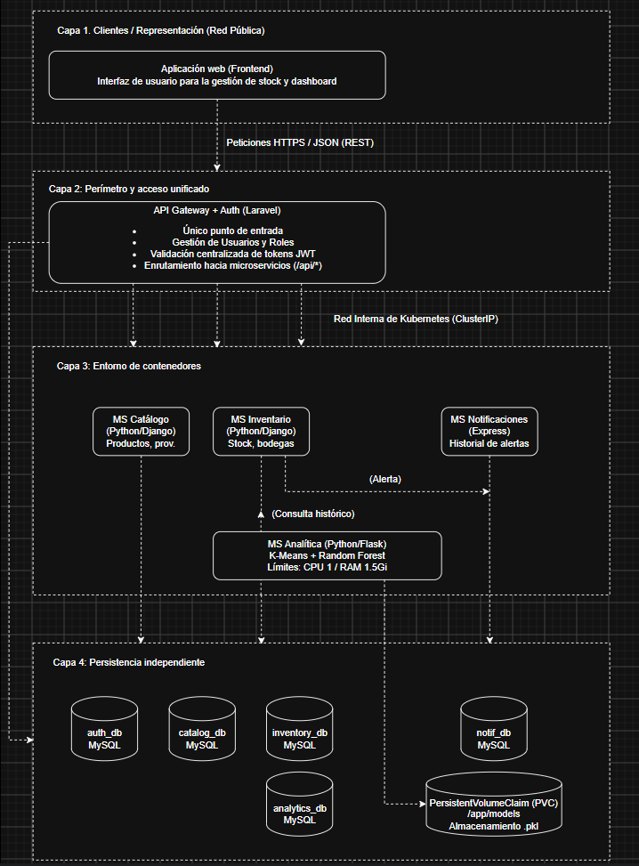

# predistock-microservices

Sistema de gestión de inventarios basado en microservicios para **PrediStock**, una distribuidora de productos de consumo masivo con múltiples bodegas regionales. Incluye un microservicio de analítica que aplica minería de datos para segmentar productos por rotación y predecir la demanda por bodega.

Proyecto de Ingeniería de Software II, Universidad Nacional de Colombia, sede Manizales.
Integrantes: Sebastián Giraldo Montoya y Cristian Alfredo Bedoya Beltrán.

## Arquitectura

| Componente | Tecnología | Base de datos | Puerto local | Documentación |
|---|---|---|---|---|
| API Gateway | Laravel | — | 8000 | [gateway](gateway/README.md) |
| ms-usuarios | Express | PostgreSQL | 3000 | [ms-usuarios](ms-usuarios/README.md) |
| ms-catalogo | Django | PostgreSQL | 8001 | [ms-catalogo](ms-catalogo/README.md) |
| ms-existencias | Django | PostgreSQL | 8002 | [ms-existencias](ms-existencias/README.md) |
| ms-notificaciones | Express | — | 5001 | [ms-notificaciones](ms-notificaciones/README.md) |
| ms-analitica | Flask | PostgreSQL | 5000 | [ms-analitica](ms-analitica/README.md) |

Cada microservicio contiene en su carpeta `docs/` el modelo de datos (imagen y código de DBDiagram), el contrato OpenAPI (`*-openapi.yaml`) y las capturas del contrato (`Contratos_api/`).

## Documentación del proyecto

### Entregable 1 y 2
Documento del proyecto: [Word](https://docs.google.com/document/d/1pFcNoO7ipG6wNtiSa-vUY8vs0gyYko1cDF7qsKA8QlI/edit?usp=sharing)

Bitácora con el historial de uso de inteligencia artificial sobre el proyecto: [Excel](https://docs.google.com/spreadsheets/d/1wuUlhUjcsTYM6YiBSMaE9YGNzpfD2nWwGhTXV3rdr9c/edit?usp=sharing)
