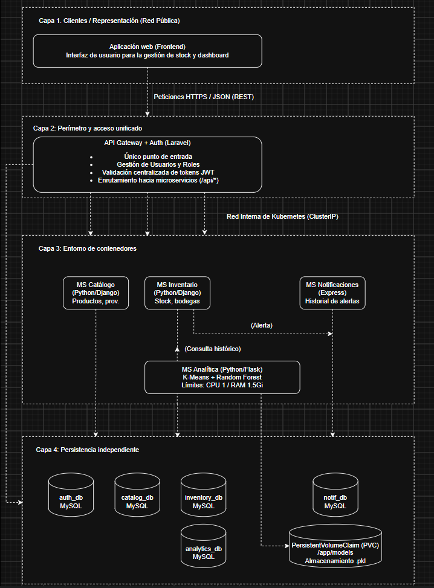

# predistock-microservices

Sistema de gestión de inventarios basado en microservicios para **PrediStock**, una distribuidora de productos de consumo masivo con múltiples bodegas regionales. Incluye un microservicio de analítica que aplica minería de datos para segmentar productos por rotación y predecir la demanda por bodega.

Proyecto de Ingeniería de Software II, Universidad Nacional de Colombia, sede Manizales.
Integrantes: Sebastián Giraldo Montoya y Cristian Alfredo Bedoya Beltrán.

## Arquitectura



Todo el tráfico entra por el **API Gateway** (puerto 8000), que valida el token JWT y reenvía la petición al microservicio correspondiente. Los microservicios y las bases de datos **no se publican** hacia el computador: solo son alcanzables desde la red interna de Docker.

| Componente | Tecnología | Base de datos | Puerto | Documentación |
|---|---|---|---|---|
| API Gateway | Laravel (PHP) | — | **8000** (publicado) | [api-gateway](api-gateway/README.md) |
| Frontend | React / Vite | — | **5173** (publicado) | [frontend](frontend) |
| ms-usuarios | Express | PostgreSQL | 3000 (interno) | [ms-usuarios](ms-usuarios/README.md) |
| ms-catalogo | Django | PostgreSQL | 8001 (interno) | [ms-catalogo](ms-catalogo/README.md) |
| ms-existencias | Django | PostgreSQL | 8002 (interno) | [ms-existencias](ms-existencias/README.md) |
| ms-notificaciones | Express | — | 5001 (interno) | [ms-notificaciones](ms-notificaciones/README.md) |
| ms-analitica | Flask | PostgreSQL | 5000 (interno) | [ms-analitica](ms-analitica/README.md) |

Cada microservicio contiene en su carpeta `docs/` el modelo de datos (imagen y código de DBDiagram), el contrato OpenAPI (`*-openapi.yaml`) y las capturas del contrato (`Contratos_api/`).

## Cómo ejecutar el sistema completo

### Requisitos

- **Docker** con Docker Compose v2 (Docker Desktop en Windows y macOS, o Docker Engine en Linux).
- **Git**.
- Los puertos **8000** y **5173** libres.
- Unos 6 GB de memoria disponibles para Docker.

No hace falta instalar Node, Python ni PHP: todo corre dentro de contenedores.

### Pasos

**1. Clonar el repositorio**

```bash
git clone <url-del-repositorio>
cd predistock-microservices
```

**2. Crear el archivo `.env`** en la raíz del repositorio (no se sube a git porque contiene secretos). Copiar este contenido tal cual; son valores de desarrollo:

```env
JWT_SECRET=predistock_jwt_desarrollo_2026
POSTGRES_USER=predi_user
POSTGRES_PASSWORD=predi_password
AUTH_DB_NAME=autentificacion_db
ANALYTICS_DB_NAME=analitica_db
```

Sin este archivo, Docker Compose avisa de que las variables están vacías y el gateway y `ms-usuarios` no arrancan.

**3. Construir y levantar todo**

```bash
docker compose up -d --build
```

La primera vez descarga imágenes y construye, y puede tardar varios minutos. Además del sistema, el comando ejecuta tres servicios de un solo uso que cargan datos de demostración (usuarios, catálogo y existencias). El de existencias simula un año de movimientos y tarda **entre 2 y 4 minutos**.

**4. Esperar a que termine la carga de datos**

```bash
docker compose ps -a
```

El sistema está listo cuando los servicios `seed-usuarios`, `seed-catalogo` y `seed-existencias` aparecen como `Exited (0)` y los demás como `Up` (los que tienen verificación de salud, como `healthy`).

**5. Abrir el sistema**

- Interfaz web: <http://localhost:5173>
- API Gateway: <http://localhost:8000/api>

**6. Entrenar la analítica (una sola vez).** El entrenamiento no se dispara solo: se hace desde la pantalla de analítica del frontend o con la API (ver más abajo). Sin este paso, el panel de analítica queda vacío.

### Usuarios de demostración

| Rol | Correo | Contraseña | Qué puede hacer |
|---|---|---|---|
| Administrador | `admin@predistock.com` | `Admin2026*` | Todo |
| Operador de bodega | `operador@predistock.com` | `Operador2026*` | Consultar y registrar movimientos, traslados, devoluciones y recepciones **solo en su bodega** (bodega 1) |
| Analista | `analista@predistock.com` | `Analista2026*` | Consultar todo y usar la analítica |

### Probar la API con curl

```bash
# 1. Iniciar sesión y guardar el token
curl -s -X POST http://localhost:8000/api/auth/login \
  -H "Content-Type: application/json" \
  -d '{"email":"admin@predistock.com","password":"Admin2026*"}'

# 2. Usar el token (reemplazar <TOKEN> por el valor del campo "token")
curl -s -H "Authorization: Bearer <TOKEN>" "http://localhost:8000/api/catalogo/productos?page_size=5"
curl -s -H "Authorization: Bearer <TOKEN>" "http://localhost:8000/api/existencias/stock?bodega_id=1"

# 3. Entrenar la analítica (requiere rol ADMIN)
curl -s -X POST -H "Authorization: Bearer <TOKEN>" -H "Content-Type: application/json" -d "{}" \
  http://localhost:8000/api/analytics/train
```

Rutas disponibles por el gateway: `/api/usuarios`, `/api/catalogo`, `/api/existencias`, `/api/notifications` y `/api/analytics`. El detalle de cada ruta está en el contrato OpenAPI de su microservicio.

### Datos de demostración

Al levantar el sistema se carga automáticamente:

- **Usuarios:** los tres de la tabla anterior.
- **Catálogo:** 3 unidades de medida, 7 categorías, 4 proveedores y 10 productos (`PRD-001` a `PRD-010`).
- **Existencias:** 3 bodegas (`SEED-B1`, `SEED-B2`, `SEED-B3`), 30 series producto-bodega con 12 meses de kardex (unas 2.400 operaciones), órdenes de compra, traslados, devoluciones, lotes con vencimiento y algunas series bajo el mínimo para provocar alertas.

La carga es idempotente: volver a ejecutar `docker compose up -d` no duplica datos.

### Detener, reiniciar y limpiar

```bash
docker compose down        # detiene todo y conserva los datos
docker compose up -d       # vuelve a levantarlo
docker compose down -v     # detiene todo y BORRA los datos (volúmenes); la próxima vez se vuelven a sembrar
```

### Problemas frecuentes

| Síntoma | Causa y solución |
|---|---|
| Avisos `The "JWT_SECRET" variable is not set` y el gateway no arranca | Falta el archivo `.env` (paso 2). |
| El puerto 8000 o 5173 ya está en uso | Cerrar el programa que lo usa o cambiar el puerto publicado en `docker-compose.yml`. |
| El panel de analítica sale vacío | Falta entrenar (paso 6). |
| Existencias aparece sin datos | La carga tarda unos minutos; revisar con `docker compose ps -a` y `docker compose logs seed-existencias`. |
| `ms-usuarios` falla con `Cannot find module` | Reconstruir ese servicio: `docker compose up -d --build ms-usuarios`. |
| Se quiere inspeccionar una base de datos | Las bases no se publican. Agregar temporalmente `ports` al servicio de la base en el compose (hay un comentario con el ejemplo). |

## Pruebas

### Pruebas automáticas de cada microservicio

```bash
docker compose exec ms-catalogo python manage.py test catalogo        # 122 pruebas
docker compose exec ms-existencias python manage.py test inventario   # 98 pruebas
cd ms-notificaciones && npm install && npm test                       # 35 pruebas (jest)
```

### Pruebas de rendimiento (Locust)

El archivo [`performance-tests/locustfile.py`](performance-tests/locustfile.py) contiene las 15 pruebas de cada integrante, en dos clases separadas: `Pruebas_Cristian` (ms-usuarios, ms-analitica y API Gateway) y `Pruebas_Sebastian` (ms-catalogo y ms-existencias). Todas pasan por el gateway. Las pruebas de escritura de `Pruebas_Sebastian` usan la bodega `PERF-B1` y productos con prefijo `PERF-`, para no tocar los datos de demostración.

**Con interfaz web.** Locust corre en su propio contenedor, que solo arranca bajo demanda (perfil `testing`):

```bash
docker compose --profile testing up -d locust
```

Abrir <http://localhost:8089>, elegir la clase a ejecutar, el número de usuarios y la rampa. Para detener solo Locust: `docker compose stop locust`.

**Sin interfaz** (ejemplo: 100 usuarios, rampa de 50 por segundo, 2 minutos, con informe HTML):

```bash
docker compose --profile testing run --rm locust locust -f locustfile.py --headless \
  -u 100 -r 50 -t 2m -H http://api-gateway:8000 \
  --html resultados-entrega3/informe.html Pruebas_Sebastian
```

### Resultados preliminares (Entrega 3)

Informes completos en [`performance-tests/resultados-entrega3/`](performance-tests/resultados-entrega3/). Todas las corridas se hicieron en un solo computador, con el sistema y Locust en la misma máquina, así que los tiempos absolutos son orientativos.

**Pruebas de catálogo y existencias (Sebastián)** — 2 minutos por corrida:

| Carga | Peticiones | Fallos | Mediana | p95 | Peticiones/s |
|---|---|---|---|---|---|
| 20 usuarios, rampa 5 | 1.362 | 0 | 160 ms | 680 ms | 11,4 |
| 100 usuarios, rampa 50 | 1.567 | 0 | 5,1 s | 6,8 s | 13,1 |
| 200 usuarios, rampa 30 | 1.233 | 0 | 10 s | 26 s | 10,3 |

**Pruebas de usuarios, analítica y gateway (Cristian):**

| Carga | Peticiones | Fallos | Mediana | p95 | Peticiones/s |
|---|---|---|---|---|---|
| 20 usuarios, rampa 5 | 266 | 1 | 43 ms | 29 s* | 5,5 |
| 100 usuarios, rampa 50 | 414 | 1 | 6,4 s | 30 s | 8,6 |
| 200 usuarios, rampa 30 | 463 | 1 | 8,0 s | 38 s | 8,4 |

\* En la corrida de 20 usuarios la mediana es de 43 ms; el p95 lo elevan unas pocas peticiones de unos 30 s de las primeras rutas de analítica y gateway (arranque en frío).

**Lectura de los resultados**

- Con **20 usuarios** el sistema cumple RNF06 (consultas por debajo de 2 s) en catálogo y existencias.
- Con **100 y 200 usuarios** no se cumple: el sistema se estanca en unas **10 a 13 peticiones por segundo sin importar cuántos usuarios haya**, y el tiempo de respuesta crece de forma proporcional a los usuarios.
- Todos los endpoints, de catálogo, de existencias y de escritura, tardan casi lo mismo bajo carga (6 a 7 s de mediana con 100 usuarios). Eso apunta a un punto común por el que pasan todas las peticiones, el **API Gateway**, que se ejecuta con el servidor de desarrollo de PHP (`php artisan serve`), el cual atiende una petición a la vez. Los microservicios de Django (gunicorn con 3 procesos) y las bases de datos quedan prácticamente ociosas.
- El inicio de sesión también es lento con muchos usuarios simultáneos (el hash de contraseñas consume CPU).
- Estos resultados son la **línea base "antes"** para las optimizaciones de la Entrega 4 (más procesos en el gateway, servidor de producción y revisión del login), que se compararán "antes y después".

## Documentación del proyecto

### Entregable 1 y 2
Documento del proyecto: [Word](https://docs.google.com/document/d/1pFcNoO7ipG6wNtiSa-vUY8vs0gyYko1cDF7qsKA8QlI/edit?usp=sharing)

Bitácora con el historial de uso de inteligencia artificial sobre el proyecto: [Excel](https://docs.google.com/spreadsheets/d/1wuUlhUjcsTYM6YiBSMaE9YGNzpfD2nWwGhTXV3rdr9c/edit?usp=sharing)

## Estado y alcance de la Entrega 3

- Microservicios implementados y accesibles únicamente a través del API Gateway.
- Comunicación entre microservicios por REST: existencias consulta a catálogo y avisa a notificaciones, y analítica lee el histórico y el stock de existencias a través del gateway.
- Un Dockerfile por microservicio y orquestación local con Docker Compose.
- Datos de demostración cargados automáticamente.
- 15 pruebas de rendimiento por integrante con resultados preliminares.
- La orquestación en Kubernetes no forma parte de esta entrega.
