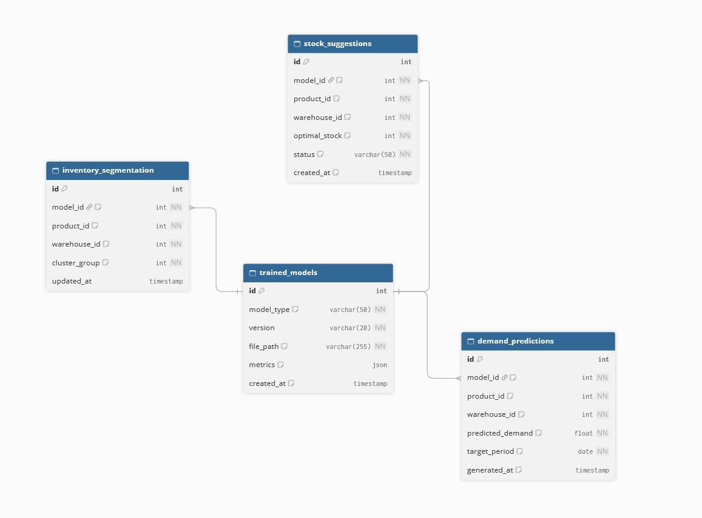
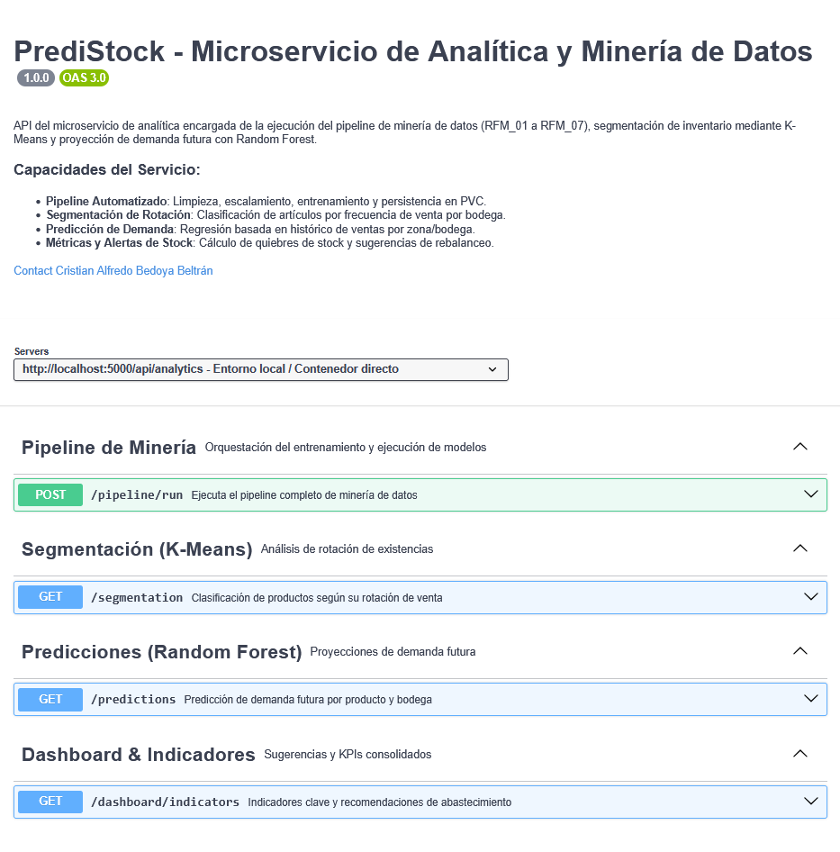

# ms-analitica

Microservicio encargado del pipeline de minería de datos de PrediStock: toma el histórico de movimientos del microservicio de existencias, lo limpia y normaliza, segmenta los productos por rotación con K-Means, predice la demanda por bodega con Random Forest y genera sugerencias de distribución de stock e indicadores para el dashboard.

| | |
|---|---|
| **Tecnología** | Python / Flask (pandas, scikit-learn) |
| **Base de datos** | PostgreSQL (`analitica_db`) |
| **Almacenamiento de modelos** | Volumen persistente (PVC) montado en `/app/models` |
| **Puerto local** | 5000 |
| **Ruta vía Gateway** | `/api/analytics` |
| **Requerimientos** | RFM_01 a RFM_07, RF14, RNFM_01, RNFM_02, RNFM_03 |
| **Depende de** | ms-existencias (consulta del histórico de movimientos y stock) |

## Modelo de datos

Para la representación del modelo de datos se utilizó DBDiagram. El código fuente del diagrama está en [`docs/db-diagram.txt`](docs/db-diagram.txt) para futuras modificaciones.

| Tabla | Qué representa |
|---|---|
| `trained_models` | Cada modelo entrenado (K-Means o Random Forest), su versión, la ruta del archivo en el volumen persistente y sus métricas |
| `inventory_segmentation` | Grupo de rotación asignado por K-Means a cada producto en cada bodega (RFM_05) |
| `demand_predictions` | Demanda futura estimada por Random Forest por producto, bodega y periodo (RFM_06) |
| `stock_suggestions` | Cantidad óptima de stock sugerida por producto y bodega (RFM_07) |

**Decisiones principales**
- **Los modelos no se guardan en la base de datos**, solo su ruta. Los archivos `.pkl` o `.joblib` viven en el volumen persistente, para no reentrenar en cada reinicio del contenedor (RNFM_02).
- **Cada resultado referencia al modelo que lo generó** (`model_id`), lo que permite saber con qué versión se calculó cada segmentación, predicción o sugerencia.
- **`product_id` y `warehouse_id` son referencias lógicas** a los microservicios de catálogo y existencias: no tienen llave foránea física (RNF02). Los datos se obtienen por API, nunca accediendo a la base de otro servicio.
- **Control de calidad (RNFM_03):** un modelo de Random Forest solo reemplaza al vigente si alcanza R² > 0.70.

## Contrato de API

Contrato OpenAPI: [`docs/analitica-openapi.yaml`](docs/analitica-openapi.yaml). Para visualizarlo, copiar su contenido en [Swagger Editor](https://editor.swagger.io/).

Capturas por endpoint en [`docs/Contratos_api/`](docs/Contratos_api/): pipeline (`metodo_run`), segmentación (`metodo_segmentation`), predicciones (`metodo_predictions`) e indicadores (`metodo_indicators`).
