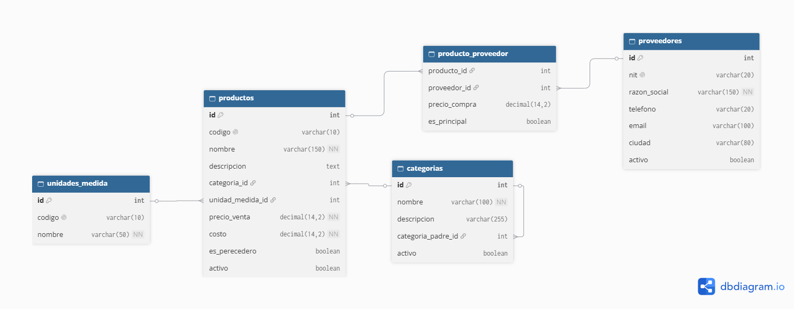
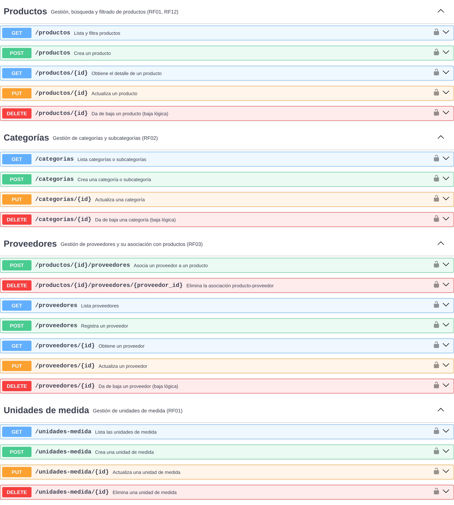

# ms-catalogo

Microservicio encargado de los datos maestros de PrediStock: productos, categorías y subcategorías, proveedores y unidades de medida. Es la fuente de verdad sobre qué productos existen y quién los suministra; el microservicio de existencias lo consulta para validar productos y proveedores.

| | |
|---|---|
| **Tecnología** | Python / Django |
| **Base de datos** | PostgreSQL (`catalogo_db`) |
| **Puerto local** | 8001 |
| **Ruta vía Gateway** | `/api/catalogo` |
| **Requerimientos** | RF01, RF02, RF03, RF12 |
| **Lo consume** | ms-existencias (`GET /productos/{id}` y `GET /proveedores/{id}`) |

## Modelo de datos

Para la representación del modelo de datos se utilizó DBDiagram. El código fuente del diagrama está en [`docs/db-diagram.txt`](docs/db-diagram.txt) para futuras modificaciones.



**Decisiones principales**
- **Categorías y subcategorías en una sola tabla** mediante una relación recursiva (`categoria_padre_id`): una categoría con padre `NULL` es principal.
- **Producto y proveedor es una relación N:M** (`producto_proveedor`) con atributos propios: precio de compra y proveedor principal.
- **`id` y `codigo`:** `id` es la llave técnica que usan los demás servicios; `codigo` es el SKU o código de barras que usan las personas (RF01, RF12).
- **Baja lógica** (`activo`) en productos, categorías y proveedores, porque otros servicios guardan referencias a ellos.

## Contrato de API

Contrato OpenAPI: [`docs/catalogo-openapi.yaml`](docs/catalogo-openapi.yaml). Para visualizarlo, copiar su contenido en [Swagger Editor](https://editor.swagger.io/).



Capturas por grupo en [`docs/Contratos_api/`](docs/Contratos_api/): Productos, Categorías, Proveedores, Unidades de medida y Schemas.

## Identidad y permisos

El servicio no valida el JWT: confía en las cabeceras `X-Usuario-Id` y `X-Rol` que agrega el API Gateway (`catalogo/identidad.py`).

- **Lecturas (`GET`):** no exigen identidad. `ms-existencias` consulta productos y proveedores por la red interna, sin cabeceras. Quien filtra el acceso de los usuarios es el Gateway.
- **Escrituras (`POST`, `PUT`, `DELETE`):** solo rol `ADMIN`, igual que la ruta del Gateway. Otro rol, o ninguna cabecera, recibe `403 SIN_PERMISO`.

Los errores tienen siempre la forma `{"error": CODIGO, "mensaje": ...}`: `DATOS_INVALIDOS` (400), `SIN_PERMISO` (403), `NO_ENCONTRADO` (404), `CONFLICTO` (409), y los específicos `UNIDAD_EN_USO` y `CATEGORIA_EN_USO` (409).

**Qué necesita ms-existencias de la respuesta:** `GET /productos/{id}` devuelve `codigo`, `nombre`, `costo`, `es_perecedero` y `activo`; `GET /proveedores/{id}` devuelve `activo`. Ambos devuelven también los registros dados de baja (con `activo: false`) en lugar de 404, para que existencias distinga entre "no existe" e "inactivo".

## Reglas de negocio

- **Baja lógica** en productos, categorías y proveedores. El `PUT` no reactiva registros.
- **Categorías:** el nombre es único dentro del mismo nivel; una categoría no puede ser su propio padre ni de una de sus descendientes (400); solo se da de baja si no tiene productos ni subcategorías activas (409). Filtrar productos por `categoria_id` incluye las subcategorías.
- **Códigos y NIT únicos** sin distinguir mayúsculas (409).
- **Proveedor principal:** un producto solo tiene un proveedor principal; al asociar uno nuevo con `es_principal: true`, el anterior deja de serlo.
- **Unidades de medida:** se eliminan de verdad, pero solo si ningún producto las usa (409 `UNIDAD_EN_USO`).
- **Nota sobre el modelo:** `producto_proveedor` tiene un `id` propio además de la restricción única (producto, proveedor), porque Django 5.0/5.1 no admite llaves primarias compuestas.
- La base de datos arranca vacía: antes de crear productos hay que crear al menos una unidad de medida y una categoría.

## Cómo se ejecuta

El servicio corre dentro del `docker-compose.yml` de la raíz del repositorio:

```bash
docker compose up -d --build catalogo-db ms-catalogo
docker compose ps                                   # ms-catalogo debe quedar "healthy"
docker compose logs -f ms-catalogo
```

Al iniciar, el contenedor aplica las migraciones y arranca gunicorn en el puerto 8001.

**El puerto 8001 no se publica hacia el computador**, por la misma razón que en existencias: confía en las cabeceras del Gateway. Para usarlo, entrar por `http://localhost:8000/api/catalogo/...`. Solo para depurar, agregar temporalmente `ports: ["8001:8001"]` al servicio en el compose.

Para activar la validación en existencias, poner `CATALOGO_VALIDACION=true` en `ms-existencias` una vez que haya productos y proveedores cargados.

### Variables de entorno

| Variable | Valor por defecto | Para qué sirve |
|---|---|---|
| `DATABASE_URL` | SQLite local (solo desarrollo y pruebas) | Conexión a `catalogo_db` |
| `DJANGO_SECRET_KEY` | clave de desarrollo | Debe cambiarse fuera de desarrollo |
| `DJANGO_DEBUG` | `false` | |
| `DJANGO_ALLOWED_HOSTS` | `*` | |

Hay una plantilla en [`.env.example`](.env.example).

## Pruebas

Pruebas automáticas de comportamiento, en [`catalogo/tests/`](catalogo/tests/).

```bash
docker compose exec ms-catalogo python manage.py test catalogo
```

Son 95 pruebas: productos (alta, edición, baja, filtros, paginación y detalle que consume existencias), categorías (jerarquía, ciclos, baja), proveedores, asociación producto-proveedor, unidades de medida, permisos por rol y formato de errores.
