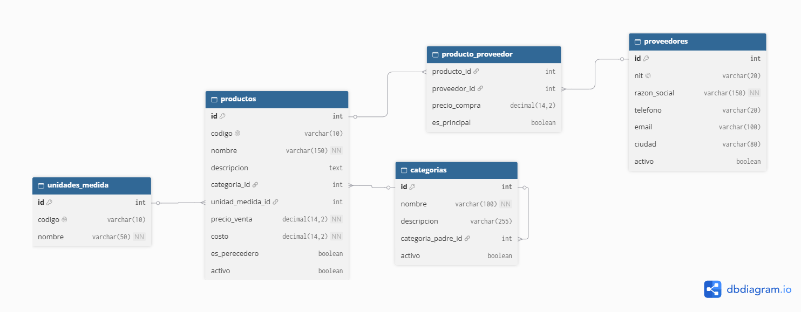
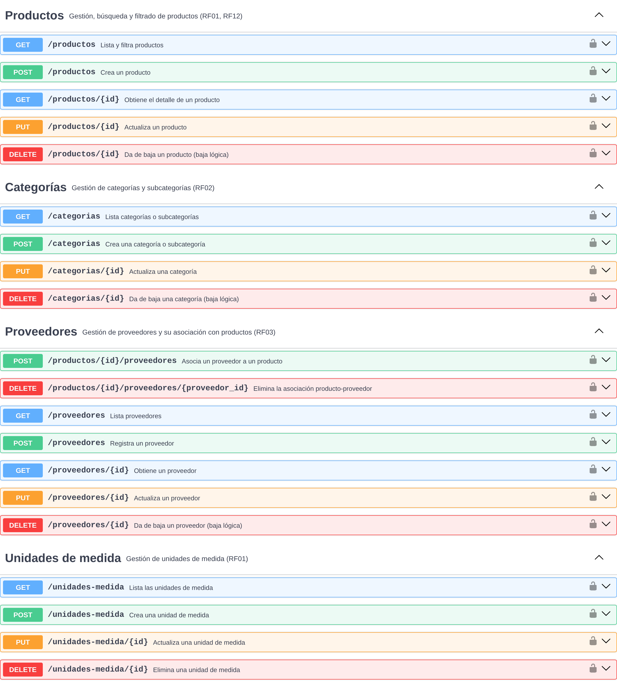

# ms-catalogo

Microservicio encargado de los datos maestros de PrediStock: productos, categorías y subcategorías, proveedores y unidades de medida. Es la fuente de verdad sobre qué productos existen y quién los suministra; el microservicio de existencias lo consulta para validar productos y proveedores.

| | |
|---|---|
| **Tecnología** | Python / Django |
| **Base de datos** | PostgreSQL (`catalogo_db`) |
| **Puerto local** | 8001 |
| **Ruta vía Gateway** | `/api/catalogo` |
| **Requerimientos** | RF01, RF02, RF03, RF12 |

## Modelo de datos

Para la representación del modelo de datos se utilizó DBDiagram. El código fuente del diagrama está en [`docs/db-diagram.txt`](docs/db-diagram.txt) para futuras modificaciones.

**Decisiones principales**
- **Categorías y subcategorías en una sola tabla** mediante una relación recursiva (`categoria_padre_id`): una categoría con padre `NULL` es principal.
- **Producto y proveedor es una relación N:M** (`producto_proveedor`) con atributos propios: precio de compra y proveedor principal.
- **`id` y `codigo`:** `id` es la llave técnica que usan los demás servicios; `codigo` es el SKU o código de barras que usan las personas (RF01, RF12).
- **Baja lógica** (`activo`) en productos, categorías y proveedores, porque otros servicios guardan referencias a ellos.

## Contrato de API

Contrato OpenAPI: [`docs/catalogo-openapi.yaml`](docs/catalogo-openapi.yaml). Para visualizarlo, copiar su contenido en [Swagger Editor](https://editor.swagger.io/).

Capturas por grupo en [`docs/Contratos_api/`](docs/Contratos_api/): Productos, Categorías, Proveedores, Unidades de medida y Schemas.
