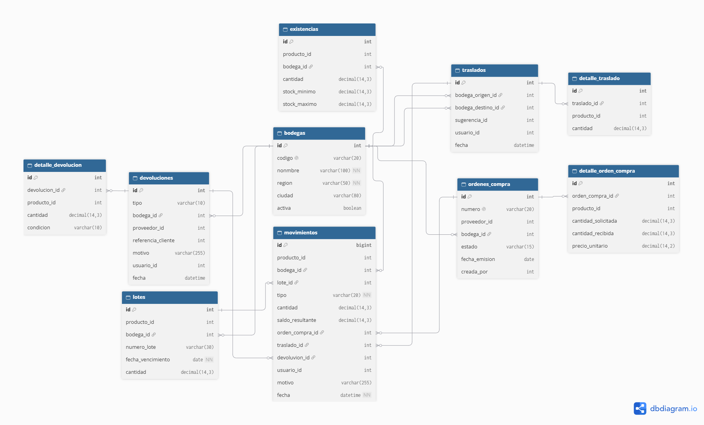
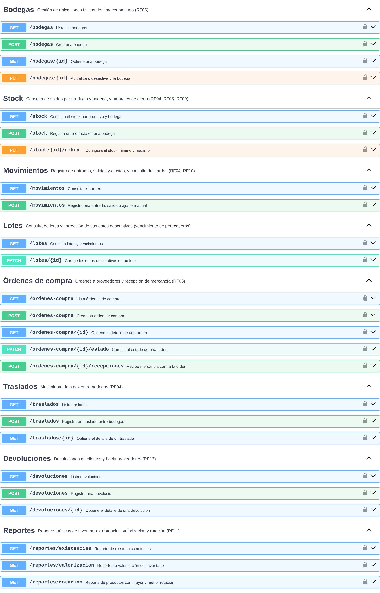

# ms-existencias

Microservicio encargado de controlar cuánto hay de cada producto, dónde está y cómo se mueve: stock por bodega, kardex de movimientos, lotes con fecha de vencimiento, órdenes de compra, traslados, devoluciones y reportes básicos de inventario.

| | |
|---|---|
| **Tecnología** | Python / Django |
| **Base de datos** | PostgreSQL (`existencias_db`) |
| **Puerto local** | 8002 |
| **Ruta vía Gateway** | `/api/existencias` |
| **Requerimientos** | RF04, RF05, RF06, RF09, RF10, RF11, RF13 |
| **Depende de** | ms-catalogo (validar productos y proveedores), ms-notificaciones (alertas de stock bajo) |

## Modelo de datos

Para la representación del modelo de datos se utilizó DBDiagram. El código fuente del diagrama está en [`docs/db-diagram.txt`](docs/db-diagram.txt) para futuras modificaciones.

**Regla central:** todo documento (orden de compra, traslado o devolución) genera movimientos, y todo movimiento actualiza las existencias.

| Capa | Tablas | Qué representa |
|---|---|---|
| Núcleo | `bodegas`, `existencias`, `movimientos` | Dónde está el stock, cuánto hay y qué pasó |
| Apoyo | `lotes` | Fecha de vencimiento de productos perecederos |
| Documentos | `ordenes_compra`, `traslados`, `devoluciones` y sus detalles | Por qué se movió el stock |

**Decisiones principales**
- **`movimientos` es el kardex** (RF10): solo se insertan filas; las correcciones se hacen con un movimiento de ajuste.
- **`existencias` guarda el saldo actual** para que la consulta de stock sea rápida (RNF06). Se actualiza en la misma transacción que el movimiento.
- **`producto_id`, `proveedor_id` y `usuario_id` son referencias lógicas** a otros microservicios: no tienen llave foránea física (RNF02) y se validan por API.
- **`lotes`** permite controlar el vencimiento, que es parte del problema de PrediStock.

## Contrato de API

Contrato OpenAPI: [`docs/existencias-openapi.yaml`](docs/existencias-openapi.yaml). Para visualizarlo, copiar su contenido en [Swagger Editor](https://editor.swagger.io/).

Capturas por grupo en [`docs/Contratos_api/`](docs/Contratos_api/): Bodegas, Stock, Movimientos, Lotes, Órdenes de compra, Traslados, Devoluciones, Reportes y Schemas.
