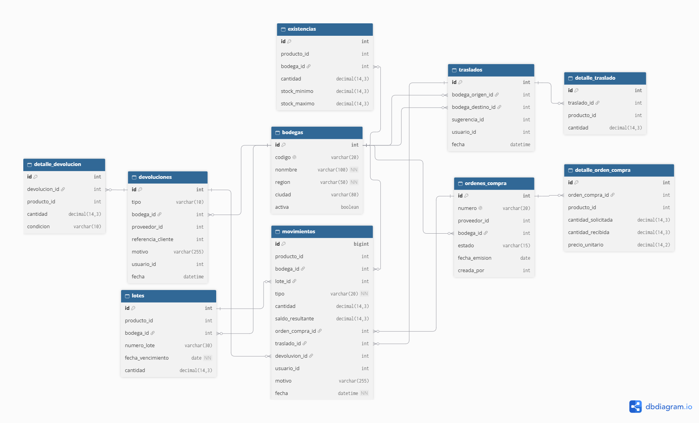
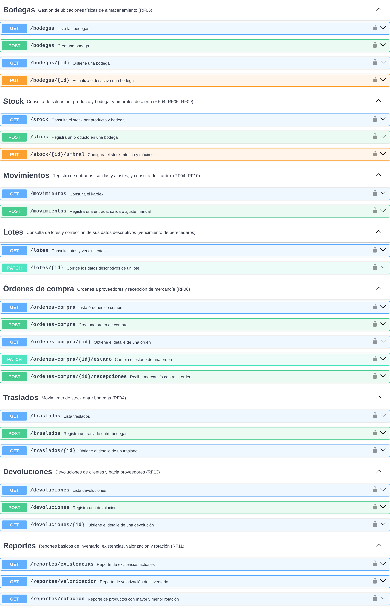

# ms-existencias

Microservicio encargado de controlar cuánto hay de cada producto, dónde está y cómo se mueve: stock por bodega, kardex de movimientos, lotes con fecha de vencimiento, órdenes de compra, traslados, devoluciones y reportes básicos de inventario.

| | |
|---|---|
| **Tecnología** | Python / Django |
| **Base de datos** | PostgreSQL (`existencias_db`) |
| **Puerto local** | 8002 |
| **Ruta vía Gateway** | `/api/existencias` |
| **Requerimientos** | RF04, RF05, RF06, RF09, RF10, RF11, RF13 |
| **Depende de** | ms-catalogo (validar productos y proveedores), ms-notificaciones (alertas de stock bajo) |

## Modelo de datos

Para la representación del modelo de datos se utilizó DBDiagram. El código fuente del diagrama está en [`docs/db-diagram.txt`](docs/db-diagram.txt) para futuras modificaciones.



**Regla central:** todo documento (orden de compra, traslado o devolución) genera movimientos, y todo movimiento actualiza las existencias.

| Capa | Tablas | Qué representa |
|---|---|---|
| Núcleo | `bodegas`, `existencias`, `movimientos` | Dónde está el stock, cuánto hay y qué pasó |
| Apoyo | `lotes` | Fecha de vencimiento de productos perecederos |
| Documentos | `ordenes_compra`, `traslados`, `devoluciones` y sus detalles | Por qué se movió el stock |

**Decisiones principales**
- **`movimientos` es el kardex** (RF10): solo se insertan filas; las correcciones se hacen con un movimiento de ajuste.
- **`existencias` guarda el saldo actual** para que la consulta de stock sea rápida (RNF06). Se actualiza en la misma transacción que el movimiento.
- **`producto_id`, `proveedor_id` y `usuario_id` son referencias lógicas** a otros microservicios: no tienen llave foránea física (RNF02) y se validan por API.
- **`lotes`** permite controlar el vencimiento, que es parte del problema de PrediStock.

## Contrato de API

Contrato OpenAPI: [`docs/existencias-openapi.yaml`](docs/existencias-openapi.yaml). Para visualizarlo, copiar su contenido en [Swagger Editor](https://editor.swagger.io/).



Capturas por grupo en [`docs/Contratos_api/`](docs/Contratos_api/): Bodegas, Stock, Movimientos, Lotes, Órdenes de compra, Traslados, Devoluciones, Reportes y Schemas.

## Cómo se ejecuta

El servicio corre dentro del `docker-compose.yml` de la raíz del repositorio:

```bash
docker compose up -d --build existencias-db ms-existencias
docker compose ps                                   # ms-existencias debe quedar "healthy"
docker compose logs -f ms-existencias
```

Al iniciar, el contenedor aplica las migraciones y arranca gunicorn en el puerto 8002.

**El puerto 8002 no se publica hacia el computador.** El servicio no valida el JWT: confía en las cabeceras `X-Usuario-Id`, `X-Rol` y `X-Bodega-Id` que agrega el API Gateway, así que solo debe ser alcanzable desde la red interna. Para usarlo desde fuera, entrar por el Gateway (`http://localhost:8000/api/existencias/...`). Solo para depurar, agregar temporalmente `ports: ["8002:8002"]` al servicio en el compose.

### Variables de entorno

| Variable | Valor por defecto | Para qué sirve |
|---|---|---|
| `DATABASE_URL` | SQLite local (solo desarrollo y pruebas) | Conexión a `existencias_db` |
| `DJANGO_SECRET_KEY` | clave de desarrollo | Debe cambiarse fuera de desarrollo |
| `DJANGO_DEBUG` | `false` | |
| `CATALOGO_SERVICE_URL` | `http://ms-catalogo:8001/api/catalogo` | Validar productos y proveedores, y leer el costo |
| `CATALOGO_VALIDACION` | `true` | Con `false` no se consulta catálogo (desarrollo sin `ms-catalogo`) |
| `NOTIFICACIONES_SERVICE_URL` | `http://ms-notificaciones:5001/api/notifications` | Destino de las alertas de stock bajo (`POST {url}/alerts`) |
| `NOTIFICACIONES_ASINCRONO` | `true` | Envía la alerta en un hilo aparte |
| `HTTP_TIMEOUT` | `3` | Segundos de espera a otros microservicios |

Hay una plantilla en [`.env.example`](.env.example).

## Pruebas

Pruebas automáticas de comportamiento, en [`inventario/tests/`](inventario/tests/). Son distintas de las pruebas de rendimiento con Locust.

```bash
docker compose exec ms-existencias python manage.py test inventario
```

Son 98 pruebas: bodegas, stock, movimientos (saldo, lotes FEFO, permisos, alertas, kardex), traslados, devoluciones, órdenes de compra, reportes y la integración con catálogo simulada. Una de ellas lanza dos salidas simultáneas sobre el mismo saldo para comprobar el bloqueo de fila, y solo se ejecuta sobre PostgreSQL.

## Reglas de negocio

- **Todo cambio de stock es un movimiento.** Se escribe en una sola transacción: se bloquea la fila de `existencias` (`SELECT ... FOR UPDATE`), se valida el saldo, se inserta el movimiento y se actualiza el saldo. Dos salidas simultáneas no pueden dejar el stock negativo.
- **FEFO.** Una salida sin `lote_id` descuenta primero el lote que vence antes y genera un movimiento por cada lote consumido. Las salidas y los traslados no toman lotes vencidos; se dan de baja con un ajuste.
- **Documentos atómicos.** Un traslado, una devolución o una recepción de orden de compra se confirman completos o no se confirman. El lote viaja con la mercancía en los traslados.
- **Permisos.** Un operador solo opera sobre la bodega de su token; crear bodegas, órdenes, umbrales y corregir lotes es solo para ADMIN.
- **Alerta de stock bajo (RF09).** Si una salida deja el saldo por debajo del mínimo, se avisa a ms-notificaciones una vez guardado el movimiento. Si notificaciones no responde, el movimiento no se ve afectado.
- **Tolerancia a fallos de catálogo.** Al crear (stock, órdenes, devoluciones a proveedor) catálogo se consulta y su caída produce `503`. Al consultar, el nombre del producto se omite y la consulta sigue respondiendo.

## Integración con otros servicios

| Servicio | Relación |
|---|---|
| ms-catalogo | Existencias lo consulta por HTTP: existencia y estado del producto o proveedor, si es perecedero, y su costo para la valorización |
| ms-notificaciones | Existencias le envía la alerta de stock bajo |
| ms-analitica | Consume `GET /api/existencias/movimientos/historico` para entrenar sus modelos |
| API Gateway | Único punto de entrada; valida el JWT y reenvía la identidad en cabeceras |

## Diferencias respecto al contrato original

El contrato de la Entrega 2 se actualizó con estos puntos que surgieron al implementar: `GET /health`, `GET /movimientos/historico`, las cabeceras `X-Total-Count` y `X-Movimientos-Ids`, y que el reporte de existencias no falla (`503`) si catálogo está caído. Las capturas de `docs/Contratos_api/` corresponden a la versión anterior del contrato.


## Datos de demostración (seeder)

Para tener datos con los que consultar el dashboard y alimentar a ms-analitica (requiere haber sembrado antes el catálogo con `seed_catalogo`):

```bash
docker compose exec ms-existencias python manage.py seed_existencias --confirmo
```

Crea 3 bodegas (`SEED-B1`..`SEED-B3`), 30 series producto-bodega con 12 meses de kardex (unas 2.000 salidas con estacionalidad y sus reposiciones), 4 órdenes de compra (pendiente, parcial, recibida y cancelada), 2 traslados, 2 devoluciones, lotes de perecederos (incluido uno próximo a vencer y uno vencido) y un estado final con 6 series en quiebre, 6 en sobrestock y el resto en nivel óptimo. Además provoca una alerta real de stock bajo.

- Todo pasa por los endpoints reales (mismas reglas de kardex, FEFO y alertas); lo único que se escribe directamente es la fecha de cada registro, porque la API no acepta fechas pasadas.
- Sin `--confirmo` solo describe lo que haría. `--hasta AAAA-MM-DD` cierra el histórico en esa fecha (por defecto, ayer).
- Los movimientos no se pueden borrar, así que el comando se detiene si ya hay movimientos. Para repetir la siembra hay que recrear el volumen de la base de existencias.
- En `docker-compose.yml` lo ejecuta automáticamente el servicio de un solo uso `seed-existencias` (con `--solo-si-vacio`, que no hace nada si ya hay datos), después de `seed-catalogo`. Con un simple `docker compose up -d --build` el sistema queda con datos, sin scripts propios de un sistema operativo. En Kubernetes serían Jobs con esta misma imagen y comando.
