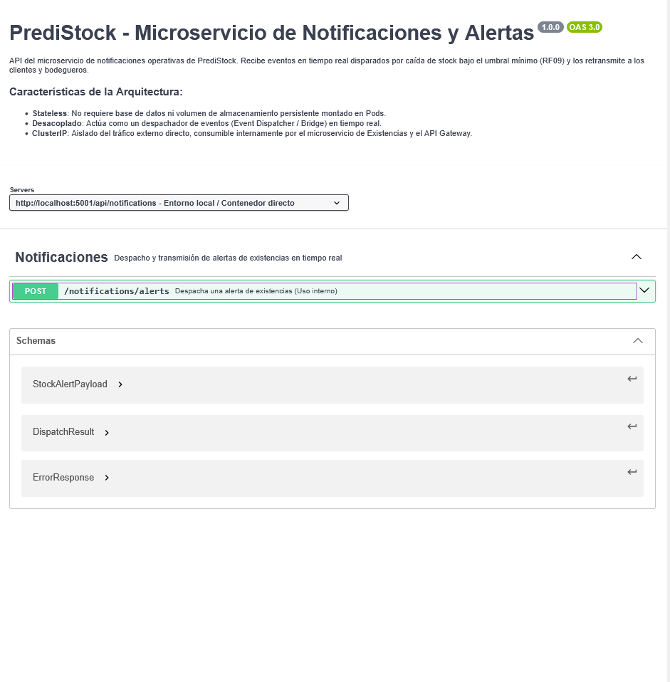

# ms-notificaciones

Microservicio encargado de despachar en tiempo real las alertas de stock de PrediStock. Recibe del microservicio de existencias el aviso de que un producto quedó por debajo de su umbral mínimo en una bodega y lo retransmite a los usuarios (RF09).

| | |
|---|---|
| **Tecnología** | Node.js / Express |
| **Base de datos** | No tiene (servicio sin estado) |
| **Puerto local** | 5001 |
| **Ruta vía Gateway** | `/api/notifications` |
| **Requerimientos** | RF09 |
| **Lo consume** | ms-existencias, cuando un movimiento deja el stock por debajo del mínimo |

## Modelo de datos

Este microservicio **no requiere base de datos ni almacenamiento persistente**. Su única función es recibir y despachar alertas en tiempo real; la información de productos, cantidades, umbrales e historial de movimientos se gestiona y almacena en el microservicio de existencias.

**Decisiones principales**
- **Sin estado (stateless):** al no guardar información, se puede reiniciar o escalar sin perder datos.
- **Despachador de eventos:** actúa como puente entre ms-existencias, que detecta el stock bajo, y los usuarios que deben recibir la alerta.
- **Uso interno:** el endpoint de alertas lo invoca ms-existencias por la red interna; no está pensado para ser llamado directamente por el frontend.

## Contrato de API

Contrato OpenAPI: [`docs/notificationes-openapi.yaml`](docs/notificationes-openapi.yaml). Para visualizarlo, copiar su contenido en [Swagger Editor](https://editor.swagger.io/).

Captura del endpoint de alertas: [`docs/contratos_api/metodo_alerts.png`](docs/contratos_api/metodo_alerts.png).
