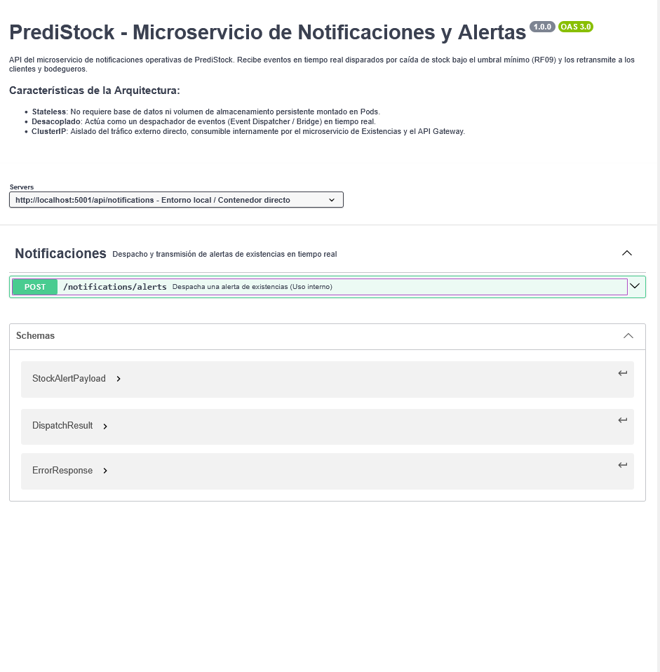

# ms-notificaciones

Microservicio encargado de despachar en tiempo real las alertas de stock de PrediStock. Recibe del microservicio de existencias el aviso de que un producto quedó por debajo de su umbral mínimo en una bodega y lo retransmite a los usuarios (RF09).

| | |
|---|---|
| **Tecnología** | Node.js / Express |
| **Base de datos** | No tiene (servicio sin estado) |
| **Puerto local** | 5001 |
| **Ruta vía Gateway** | `/api/notifications` |
| **Requerimientos** | RF09 |
| **Lo consume** | ms-existencias, cuando un movimiento deja el stock por debajo del mínimo |
| **Endpoints** | `POST /api/notifications/alerts` (uso interno), `GET /api/notifications/health` |

## Modelo de datos

Este microservicio **no requiere base de datos ni almacenamiento persistente**. Su única función es recibir y despachar alertas en tiempo real; la información de productos, cantidades, umbrales e historial de movimientos se gestiona y almacena en el microservicio de existencias.

**Decisiones principales**
- **Sin estado (stateless):** al no guardar información, se puede reiniciar o escalar sin perder datos.
- **Despachador de eventos:** actúa como puente entre ms-existencias, que detecta el stock bajo, y los usuarios que deben recibir la alerta.
- **Uso interno:** el endpoint de alertas lo invoca ms-existencias por la red interna; no está pensado para ser llamado directamente por el frontend.

## Contrato de API

Contrato OpenAPI: [`docs/notificationes-openapi.yaml`](docs/notificationes-openapi.yaml). Para visualizarlo, copiar su contenido en [Swagger Editor](https://editor.swagger.io/).



Captura del endpoint de alertas: [`docs/contratos_api/metodo_alerts.png`](docs/contratos_api/metodo_alerts.png).

## Cómo se ejecuta

El servicio corre dentro del `docker-compose.yml` de la raíz del repositorio. No depende de ninguna base de datos:

```bash
docker compose up -d --build ms-notificaciones
docker compose ps                                   # ms-notificaciones debe quedar "healthy"
docker compose logs -f ms-notificaciones            # aquí aparecen las alertas despachadas
```

**El puerto 5001 no se publica hacia el computador**, igual que catálogo y existencias: el endpoint de alertas es de uso interno. Para probarlo desde dentro de la red de Docker:

```bash
docker compose exec ms-notificaciones wget -qO- http://localhost:5001/api/notifications/health
```

Solo para depurar, agregar temporalmente `ports: ["5001:5001"]` al servicio en el compose.

### Variables de entorno

| Variable | Valor por defecto | Para qué sirve |
|---|---|---|
| `PORT` | `5001` | Puerto en el que escucha Express |

## Pruebas

Pruebas automáticas con Jest y Supertest, en [`tests/`](tests/). No necesitan Docker ni otros servicios:

```bash
cd ms-notificaciones
npm install
npm test
```

Son 35 pruebas: despacho de una alerta válida y su registro en el log, validación de cada campo (faltante o con tipo incorrecto), JSON malformado, cuerpo que no es JSON, rechazo de las peticiones que llegan por el Gateway, método no permitido, ruta inexistente y health check. La imagen de Docker no incluye las pruebas ni las dependencias de desarrollo.

## Comportamiento

- **Validación.** Los seis campos de `StockAlertPayload` son obligatorios. `product_id` y `warehouse_id` deben ser enteros positivos; `current_stock` y `threshold`, números mayores o iguales a 0. Se aceptan decimales porque ms-existencias envía la cantidad como decimal cuando no es entera. Si algo falla, responde `400` con los errores de cada campo: `{"error": "DATOS_INVALIDOS", "mensaje": {"product_id": ["Este campo es obligatorio."]}}`.
- **Solo uso interno.** ms-existencias llama al servicio directamente, sin cabeceras de identidad. Toda petición que llega por el API Gateway trae `X-Usuario-Id` / `X-Rol` y se rechaza con `403 SIN_PERMISO`, para que un usuario autenticado no pueda fabricar alertas. El Gateway sigue enrutando `/api/notifications/**`; esta regla es del servicio.
- **Despacho.** Sin base de datos ni cola, la alerta se registra como una línea JSON en la salida estándar (`evento: "ALERTA_DESPACHADA"`, canal, fecha y los campos de la alerta) y se responde `{"status": "delivered", "channel": "realtime_push", "timestamp": ...}`. Por ahora el canal `realtime_push` es simulado: no hay un cliente conectado que reciba la alerta. Un canal real (SSE, WebSocket o correo) se conecta en [`services/dispatcher.js`](services/dispatcher.js) sin cambiar la ruta ni el controlador.
- **Errores.** Formato uniforme `{"error": CODIGO, "mensaje": texto}`, igual que ms-catalogo y ms-existencias: `DATOS_INVALIDOS` (400), `SIN_PERMISO` (403), `NO_ENCONTRADO` (404), `METODO_NO_PERMITIDO` (405), `TIPO_NO_SOPORTADO` (415) y `ERROR_INTERNO` (500).

## Estructura

| Carpeta | Contenido |
|---|---|
| `server.js` | Aplicación Express, health check y arranque |
| `routes/` | Rutas del servicio |
| `controllers/` | Atiende la petición de alerta |
| `middlewares/` | Validación del cuerpo, rechazo de peticiones del Gateway y formato de errores |
| `services/` | Despacho de la alerta (punto de extensión para un canal real) |
| `tests/` | Pruebas con Jest y Supertest |

## Integración con otros servicios

| Servicio | Relación |
|---|---|
| ms-existencias | Le envía la alerta de stock bajo (`POST {NOTIFICACIONES_SERVICE_URL}/alerts`) después de guardar una salida que deja el saldo por debajo del mínimo. Si notificaciones no responde, el movimiento no se ve afectado |
| API Gateway | Enruta `/api/notifications/**`, pero el endpoint de alertas rechaza esas peticiones (`403`) |

## Diferencias respecto al contrato original

El contrato se actualizó (versión 1.1.0) con estos puntos que surgieron al implementar:

- La ruta es `POST /alerts` sobre el servidor `/api/notifications`. El contrato original la declaraba como `/notifications/alerts`, que habría quedado `/api/notifications/notifications/alerts` y no coincidía con lo que llaman ms-existencias y el Gateway.
- Se agregaron `GET /health` y las respuestas `403`, `405` y `415`.
- `current_stock` y `threshold` pasan de `integer` a `number` (mínimo 0), porque existencias envía decimales cuando la cantidad no es entera.
- El error usa `mensaje` en lugar de `message`, como el resto de microservicios.

Las capturas de `docs/contratos_api/` corresponden a la versión anterior del contrato.
