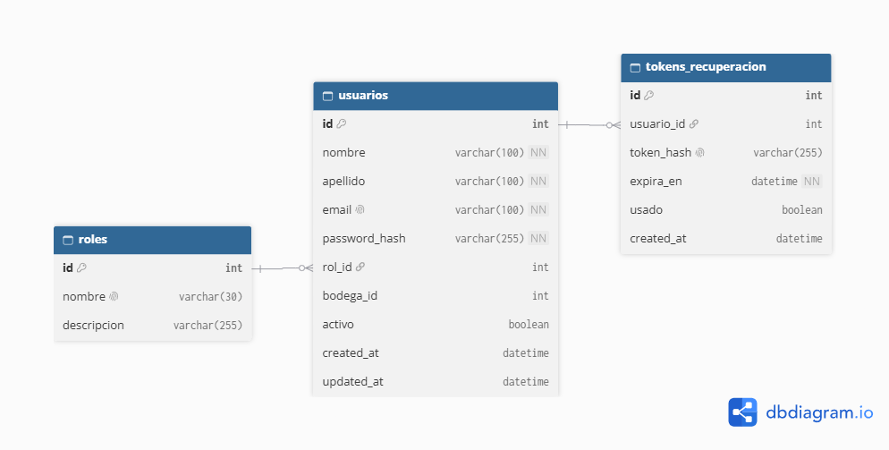
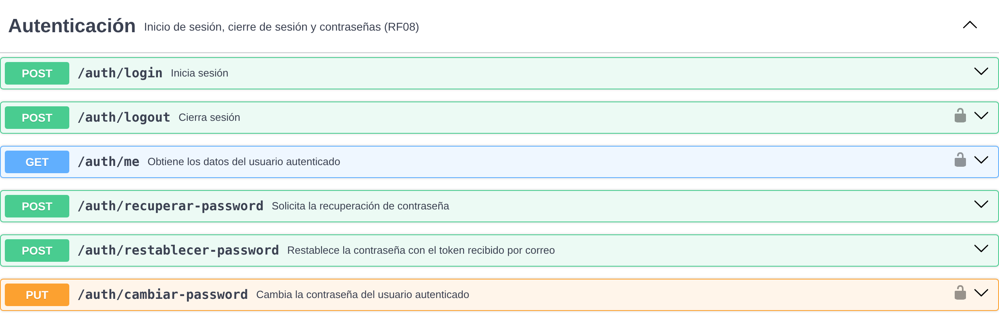

# ms-usuarios

Microservicio encargado de los usuarios, los roles y la autenticación de PrediStock: inicio y cierre de sesión, recuperación y cambio de contraseña. Emite el token JWT que el API Gateway valida en cada petición.

| | |
|---|---|
| **Tecnología** | Node.js / Express |
| **Base de datos** | PostgreSQL (`autentificacion_db`) |
| **Puerto local** | 3000 |
| **Ruta vía Gateway** | `/api/usuarios` |
| **Requerimientos** | RF07, RF08, RNF07 |

## Modelo de datos

Para la representación del modelo de datos se utilizó DBDiagram. El código fuente del diagrama está en [`docs/db-diagram.txt`](docs/db-diagram.txt) para futuras modificaciones.

**Decisiones principales**
- **Roles fijos** (ADMIN, OPERADOR_BODEGA, ANALISTA): se cargan como datos iniciales y sus permisos se definen por ruta en el API Gateway.
- **Contraseñas como hash bcrypt** (RNF07): nunca se guarda ni se devuelve la contraseña.
- **JWT sin estado:** el token no se guarda en el servidor; el Gateway verifica su firma y su expiración. Por eso no existe una tabla de sesiones. Al cerrar sesión, el cliente descarta el token, que sigue vigente hasta su expiración (duración corta).
- **`tokens_recuperacion`:** guarda solo el hash del token enviado por correo, con expiración y de un solo uso.
- **Baja lógica** (`activo`): un usuario no se elimina porque aparece en el kardex como responsable de movimientos.

## Contrato de API

Contrato OpenAPI: [`docs/usuarios-openapi.yaml`](docs/usuarios-openapi.yaml). Para visualizarlo, copiar su contenido en [Swagger Editor](https://editor.swagger.io/).

Capturas por grupo en [`docs/Contratos_api/`](docs/Contratos_api/): Descripción, Autenticación, Usuarios, Roles y Schemas.
